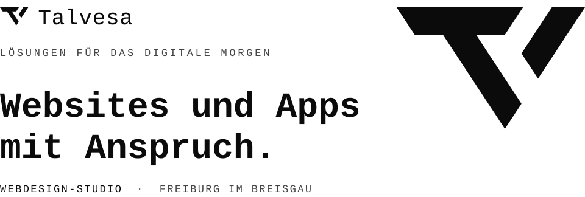
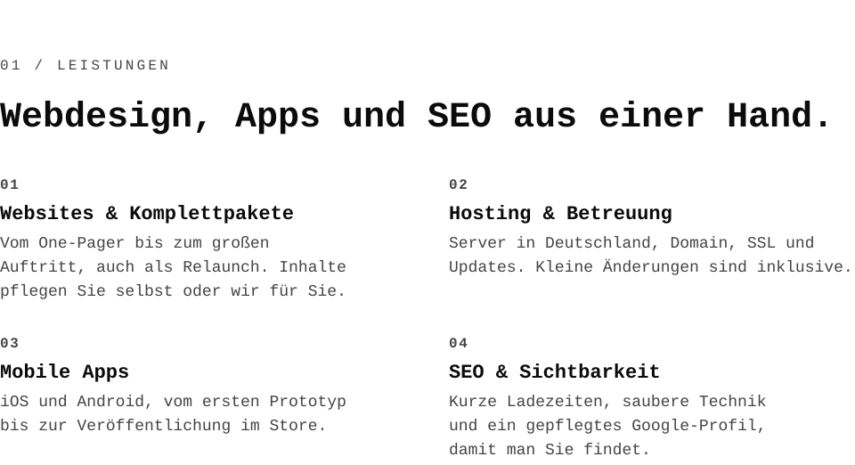
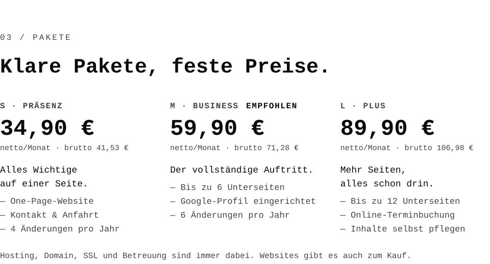
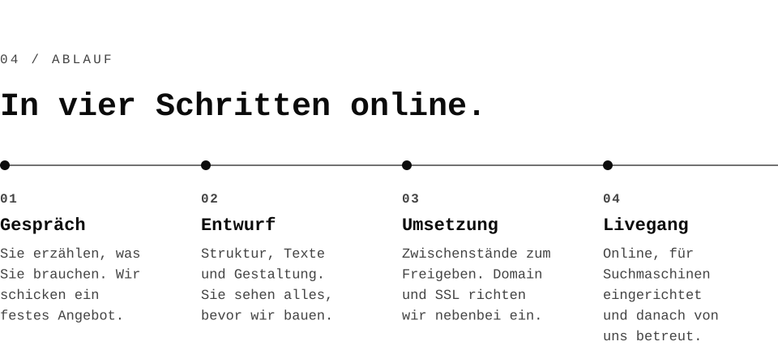
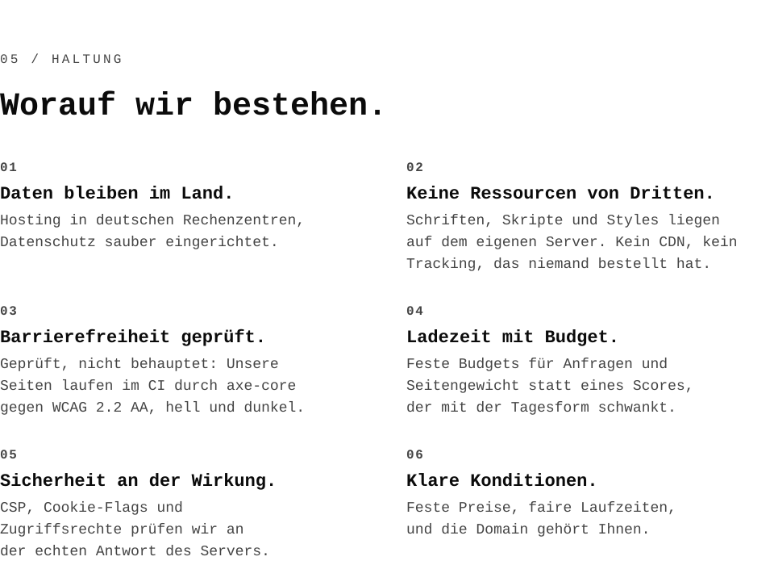

<a href="https://talvesa.de">
  <picture>
    <source media="(max-width: 600px) and (prefers-color-scheme: dark)" srcset="./assets/banner-dark-n.svg">
    <source media="(max-width: 600px)" srcset="./assets/banner-light-n.svg">
    <source media="(prefers-color-scheme: dark)" srcset="./assets/banner-dark.svg">
    
  </picture>
</a>

**Talvesa** ist ein Webdesign-Studio aus Freiburg im Breisgau. Wir gestalten und
entwickeln Websites und Apps für kleine und mittelgroße Unternehmen in ganz
Deutschland. Von der ersten Idee bis zum laufenden Betrieb, mit einem festen
Ansprechpartner und Hosting in Deutschland. Keine Hotline, kein Ticketsystem,
kein Chatbot: Sie sprechen mit den Menschen, die Ihre Website bauen.

<a href="https://talvesa.de/kontakt/">
  <picture>
    <source media="(max-width: 600px) and (prefers-color-scheme: dark)" srcset="./assets/btn-anfragen-dark-n.svg">
    <source media="(max-width: 600px)" srcset="./assets/btn-anfragen-light-n.svg">
    <source media="(prefers-color-scheme: dark)" srcset="./assets/btn-anfragen-dark.svg">
    
  </picture>
</a>
<a href="https://talvesa.de/kontakt/?rueckruf=1#kontakt-telefon">
  <picture>
    <source media="(max-width: 600px) and (prefers-color-scheme: dark)" srcset="./assets/btn-erstgespraech-dark-n.svg">
    <source media="(max-width: 600px)" srcset="./assets/btn-erstgespraech-light-n.svg">
    <source media="(prefers-color-scheme: dark)" srcset="./assets/btn-erstgespraech-dark.svg">
    
  </picture>
</a>

<picture>
  <source media="(max-width: 600px) and (prefers-color-scheme: dark)" srcset="./assets/stats-dark-n.svg">
  <source media="(max-width: 600px)" srcset="./assets/stats-light-n.svg">
  <source media="(prefers-color-scheme: dark)" srcset="./assets/stats-dark.svg">
  
</picture>

<picture>
  <source media="(max-width: 600px) and (prefers-color-scheme: dark)" srcset="./assets/leistungen-dark-n.svg">
  <source media="(max-width: 600px)" srcset="./assets/leistungen-light-n.svg">
  <source media="(prefers-color-scheme: dark)" srcset="./assets/leistungen-dark.svg">
  
</picture>

Schon eine Website? Mit dem **[kostenlosen Website-Check](https://talvesa.de/website-check/)**
sehen wir uns Ihre Seite an. Mehr unter [talvesa.de/leistungen](https://talvesa.de/leistungen/).

<picture>
  <source media="(max-width: 600px) and (prefers-color-scheme: dark)" srcset="./assets/head-referenzen-dark-n.svg">
  <source media="(max-width: 600px)" srcset="./assets/head-referenzen-light-n.svg">
  <source media="(prefers-color-scheme: dark)" srcset="./assets/head-referenzen-dark.svg">
  
</picture>

**01 — [Wiland Kummer](https://talvesa.de/referenzen/wiland/)** 
Portfolio-Website für einen Filmemacher: große Filmausschnitte, trotzdem schnell geladen.

**02 — [Stadionfinder](https://talvesa.de/referenzen/stadionfinder/)** 
Eigene App für iPhone und Android: Freunde im Stadion finden, ohne Standort und ohne Werbung.

**03 — [CloudWishlist](https://talvesa.de/referenzen/cloudwishlist/)** 
Eigene Web-App für Wunschlisten, die dichthalten. Im Browser, ohne App.

<picture>
  <source media="(max-width: 600px) and (prefers-color-scheme: dark)" srcset="./assets/pakete-dark-n.svg">
  <source media="(max-width: 600px)" srcset="./assets/pakete-light-n.svg">
  <source media="(prefers-color-scheme: dark)" srcset="./assets/pakete-dark.svg">
  
</picture>

Alle Details und die Kauf-Option: [talvesa.de/pakete](https://talvesa.de/pakete/)

<picture>
  <source media="(max-width: 600px) and (prefers-color-scheme: dark)" srcset="./assets/ablauf-dark-n.svg">
  <source media="(max-width: 600px)" srcset="./assets/ablauf-light-n.svg">
  <source media="(prefers-color-scheme: dark)" srcset="./assets/ablauf-dark.svg">
  
</picture>

<picture>
  <source media="(max-width: 600px) and (prefers-color-scheme: dark)" srcset="./assets/haltung-dark-n.svg">
  <source media="(max-width: 600px)" srcset="./assets/haltung-light-n.svg">
  <source media="(prefers-color-scheme: dark)" srcset="./assets/haltung-dark.svg">
  
</picture>

<picture>
  <source media="(max-width: 600px) and (prefers-color-scheme: dark)" srcset="./assets/head-kontakt-dark-n.svg">
  <source media="(max-width: 600px)" srcset="./assets/head-kontakt-light-n.svg">
  <source media="(prefers-color-scheme: dark)" srcset="./assets/head-kontakt-dark.svg">
  
</picture>

Es antwortet ein Mensch, meistens noch am selben Tag, per E-Mail, Telefon oder Videocall.

**Neue Projekte** · [projekte@talvesa.de](mailto:projekte@talvesa.de) 
**Bestehende Kunden** · [support@talvesa.de](mailto:support@talvesa.de) 
**Allgemein** · [info@talvesa.de](mailto:info@talvesa.de) 
**Telefon** · [+49 761 88781117](tel:+4976188781117)

<a href="https://talvesa.de/kontakt/">
  <picture>
    <source media="(max-width: 600px) and (prefers-color-scheme: dark)" srcset="./assets/btn-anfragen-dark-n.svg">
    <source media="(max-width: 600px)" srcset="./assets/btn-anfragen-light-n.svg">
    <source media="(prefers-color-scheme: dark)" srcset="./assets/btn-anfragen-dark.svg">
    
  </picture>
</a>
<a href="https://talvesa.de/kontakt/?rueckruf=1#kontakt-telefon">
  <picture>
    <source media="(max-width: 600px) and (prefers-color-scheme: dark)" srcset="./assets/btn-erstgespraech-dark-n.svg">
    <source media="(max-width: 600px)" srcset="./assets/btn-erstgespraech-light-n.svg">
    <source media="(prefers-color-scheme: dark)" srcset="./assets/btn-erstgespraech-dark.svg">
    
  </picture>
</a>

 

Werkzeuge: Python · Django · DRF · PostgreSQL · React · Vite · Sass · Bootstrap · Docker · pytest

<picture>
  <source media="(prefers-color-scheme: dark)" srcset="./assets/mark-dark.svg">
  
</picture>
 
LÖSUNGEN FÜR DAS DIGITALE MORGEN
 
<a href="https://talvesa.de/impressum/">Impressum</a> · <a href="https://talvesa.de/datenschutz/">Datenschutz</a>
