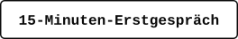
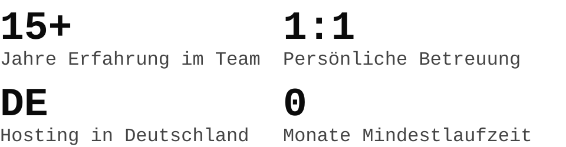

<a href="https://talvesa.de">
  <picture>
    <source media="(prefers-color-scheme: dark)" srcset="./assets/banner-dark.svg">
    <source media="(prefers-color-scheme: light)" srcset="./assets/banner-light.svg">
    
  </picture>
</a>

 

**Talvesa** ist ein Webdesign-Studio aus Freiburg im Breisgau. Wir gestalten und
entwickeln Websites und Apps für kleine und mittelgroße Unternehmen in ganz
Deutschland. Von der ersten Idee bis zum laufenden Betrieb, mit einem festen
Ansprechpartner und Hosting in Deutschland.

Keine Hotline, kein Ticketsystem, kein Chatbot: Sie sprechen mit den Menschen,
die Ihre Website bauen.

<a href="https://talvesa.de/kontakt/">
  <picture>
    <source media="(prefers-color-scheme: dark)" srcset="./assets/btn-anfragen-dark.svg">
    <source media="(prefers-color-scheme: light)" srcset="./assets/btn-anfragen-light.svg">
    
  </picture>
</a>
&nbsp;
<a href="https://talvesa.de/kontakt/?rueckruf=1#kontakt-telefon">
  <picture>
    <source media="(prefers-color-scheme: dark)" srcset="./assets/btn-erstgespraech-dark.svg">
    <source media="(prefers-color-scheme: light)" srcset="./assets/btn-erstgespraech-light.svg">
    
  </picture>
</a>

  

<picture>
  <source media="(prefers-color-scheme: dark)" srcset="./assets/stats-dark.svg">
  <source media="(prefers-color-scheme: light)" srcset="./assets/stats-light.svg">
  
</picture>

 

## Leistungen

**01 — Websites & Komplettpakete** 
Vom One-Pager bis zum umfangreichen Auftritt, gestaltet für Ihr Unternehmen,
auch als Relaunch. Texte und Bilder pflegen Sie selbst, oder wir übernehmen das
für Sie.

**02 — Hosting & Betreuung** 
Ihre Website läuft auf Servern in Deutschland, und wir halten sie aktuell.
Hosting, Domain, SSL und Sicherheits-Updates inklusive, kleine Änderungen auch.

**03 — Mobile Apps** 
Apps für iOS und Android, vom ersten Prototyp bis zur Veröffentlichung im Store.
Auch kleinere Apps für eine klare Idee.

**04 — SEO & Sichtbarkeit** 
Kurze Ladezeiten, saubere Technik und ein gepflegtes Google-Profil, damit
Kundschaft in der Region Sie findet.

Schon eine Website? Mit dem [kostenlosen Website-Check](https://talvesa.de/website-check/)
sehen wir uns Ihre Seite an. Alle Leistungen: [talvesa.de/leistungen](https://talvesa.de/leistungen/)

 

## Referenzen

**01 — Wiland Kummer** 
Portfolio-Website für einen Filmemacher: große Filmausschnitte, trotzdem schnell
geladen. [Fallstudie lesen →](https://talvesa.de/referenzen/wiland/)

**02 — Stadionfinder** 
Eigene App für iPhone und Android: Freunde im Stadion finden, ohne Standort und
ohne Werbung. [Fallstudie lesen →](https://talvesa.de/referenzen/stadionfinder/)

**03 — CloudWishlist** 
Eigene Web-App für Wunschlisten, die dichthalten, im Browser und ohne App.
[Fallstudie lesen →](https://talvesa.de/referenzen/cloudwishlist/)

 

## Pakete

**S — Präsenz** 
Alles Wichtige auf einer Seite. 34,90 € netto im Monat (brutto 41,53 €).

**M — Business** 
Der vollständige Auftritt mit bis zu 6 Unterseiten. 59,90 € netto im Monat
(brutto 71,28 €).

**L — Plus** 
Bis zu 12 Unterseiten, Terminbuchung und Inhalte selbst pflegen. 89,90 € netto
im Monat (brutto 106,98 €).

Hosting, Domain, SSL und Betreuung sind immer dabei. Websites gibt es auch zum
Kauf, Apps und größere Projekte mit festem Angebot.
Alle Details: [talvesa.de/pakete](https://talvesa.de/pakete/)

 

## Ablauf

**01 — Gespräch** 
Sie erzählen uns, was Sie brauchen. Danach bekommen Sie ein festes Angebot,
kostenlos und unverbindlich.

**02 — Entwurf** 
Wir planen Struktur, Texte und Gestaltung und zeigen Ihnen den Entwurf, bevor
wir ihn umsetzen.

**03 — Umsetzung** 
Sie sehen Zwischenstände und geben frei. Domain und SSL richten wir nebenbei ein.

**04 — Livegang** 
Die Seite geht online und wird für Suchmaschinen eingerichtet. Danach kümmern
wir uns um Updates und Sicherheit.

 

## Worauf wir bestehen

**01 — Daten bleiben im Land.** 
Hosting in deutschen Rechenzentren, Datenschutz sauber eingerichtet.

**02 — Keine Ressourcen von Dritten.** 
Schriften, Skripte und Styles liegen auf dem eigenen Server. Kein CDN, kein
Tracking, das niemand bestellt hat.

**03 — Barrierefreiheit wird geprüft, nicht behauptet.** 
Unsere öffentlichen Seiten laufen im CI durch axe-core gegen WCAG 2.2 AA, in
hellem und dunklem Design.

**04 — Ladezeit ist eine Einstellung, keine Hoffnung.** 
Feste Budgets für Anfragen und Seitengewicht statt eines Scores, der mit der
Tagesform schwankt.

**05 — Sicherheit wird an der Wirkung getestet.** 
CSP, Cookie-Flags und Zugriffsrechte prüfen wir an der echten Antwort des
Servers, nicht an der Konfiguration.

**06 — Klare Konditionen.** 
Feste Preise, faire Laufzeiten, und die Domain gehört Ihnen.

 

## Werkzeuge

Python · Django · Django REST Framework · PostgreSQL · React · Vite · Sass ·
Bootstrap · Docker · pytest

 

## Kontakt

Erzählen Sie uns von Ihrem Projekt. Es antwortet ein Mensch, meistens noch am
selben Tag, per E-Mail, Telefon oder Videocall.

**01 — Neue Projekte** 
[projekte@talvesa.de](mailto:projekte@talvesa.de)

**02 — Bestehende Kunden** 
[support@talvesa.de](mailto:support@talvesa.de)

**03 — Allgemein** 
[info@talvesa.de](mailto:info@talvesa.de)

**04 — Telefon** 
[+49 761 88781117](tel:+4976188781117)

<a href="https://talvesa.de/kontakt/">
  <picture>
    <source media="(prefers-color-scheme: dark)" srcset="./assets/btn-anfragen-dark.svg">
    <source media="(prefers-color-scheme: light)" srcset="./assets/btn-anfragen-light.svg">
    
  </picture>
</a>

  

<picture>
  <source media="(prefers-color-scheme: dark)" srcset="./assets/mark-dark.svg">
  <source media="(prefers-color-scheme: light)" srcset="./assets/mark-light.svg">
  
</picture>
 
LÖSUNGEN FÜR DAS DIGITALE MORGEN
 
<a href="https://talvesa.de/impressum/">Impressum</a> · <a href="https://talvesa.de/datenschutz/">Datenschutz</a>
